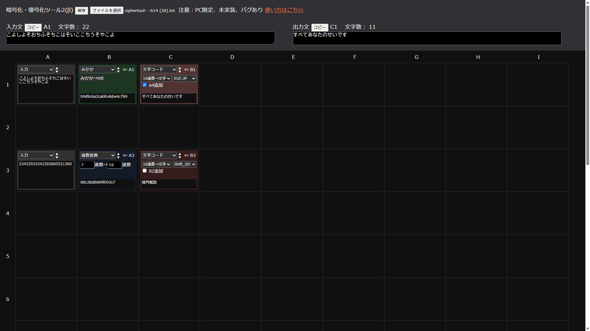

# 解読ツール
### 注意
未実装やバグが残っています

### 使い方
https://youtu.be/uGmkUytD3mM

* 入力方法
    1. 変換タイプが「入力」になっているボックスを選択
    1. 入力エリアの上に書かれた番地が入力したい場所であることを確認
    1. 入力エリアに入力

* 変換方法
    1. 変換前のボックスの下側の黒い部分をクリックし、変換したい場所までドラッグ
    1. 左上の変換タイプを指定
    1. 必要に応じてオプションを設定
    1. 変換後のボックスをクリックすると出力エリアに変換後の文字列が出力される

* ボックスの移動方法
    1. Ctrlキーを押しながら移動させたいボックスの下側の黒い部分を移動先へドラッグ

* ボックスの削除
    1. 削除したいボックスをクリックし、明るい色にする
    1. Deleteキーを押す

* リンクの変更
    1. Ctrlキーを押しながら、変換前のボックスの下側の黒い部分をクリックし、変換後の場所までドラッグ

* ファイル保存
    1. 上の「保存」ボタンをクリック

* ファイル読み込み
    1. 「ファイル選択」をクリック
    2. 開くファイルを選択

* URLコピー
    1. 「URL」ボタンをクリック

### 変換方式について
[文字↔符号：赤]
* 入力 
    変換前の文字列。「入力文」のテキストボックスから入力できる
* midi入力 
    「ファイルを選択」からmidiファイルを入力 
    取得できる内容は以下の通り
    * ノートナンバー
    * スタート時間
    * 長さ
    * モールス
    * 有無2進数
    * 音高n進数 
    　低音から`0,1,2...`として書き取る

* 文字コード 
    2進数/16進数↔文字の変換を行う 
    対応文字コードは以下の通り
    * Shift_JIS
    * US_ASCII
    * EUC-JP
    * UTF-8
    * UTF-16

    入力16進数のアルファベットは小文字にすること 
    ひらがなへの変換用の`a4`追加機能あり

* モールス 
    和文/欧文モールスの変換を行う

* 点字 
    和文点字の変換を行う

* 2タッチ 
    2タッチ(ポケベル)の変換を行う

[文字を別の文字に変換：緑]
* 文字順
    変換内容は以下の通り
    * `0,1,2...`↔`abc...`
    * `0,1,2...`↔`あいう...`
    * `0,1,2...`↔`いろは...`

* シーザー
    オプションに`rot`を入力 
    アルファベットをrot文字分後ろにずらす

* みかか
    みかか変換を行う

* 文字置換 
    変換前と変換後の文字（列）を`,`区切りで入力 
    例）オプションに`a,b,c`→`0,1,2`を入力すると、`acbabcbaccbabca`→`021012102210120`になる

* アトバシュ 
    `abc...`→`zyx...`に変換する

* ヴィジュネル 
    * オプションに`key`を入力する
    * ヴィジュネル暗号の変換する

* ポリュビオス 
    * ポリュビオス暗号の変換する

[文字の順番を変更：黄]
* 逆順

* 分割・結合

* フォーマット 
    * `{A1}`：A1の文字列そのまま
    * `{A1[i]}`：A1の文字列の(i+1)文字目
    * `{A1[l:r]}`：A1の文字列の(l+1)文字目からr文字目までの部分文字列
    * `{A1[-l:]}`：A1の文字列の後ろからl文字目以降の部分文字列 
    例）A1が`あいうえお`、B1が`かきくけこ`のとき、`お{A1[3]}{B1[:2]}`→`おえかき`

* スキュタレー

* レールフェンス

[計算：青]
* 進数変換 
    オプションに`変換前進数`と`変換後進数`を入力 
    進数変換を行う 
    使用できる文字は`0-9a-z`

* 計算 
    10進数、実数で計算を行う
    `{番地}`で、ほかで変換した値を使用可能 
    例）A1が`3`、B1が`5`のとき、`{A1}+2*{B1}`→`13` 
    ※実数で計算しているため、巨大な整数を正確に計算することはできない

### 使用例
* [モールス変換](https://ciphertoolgui2.pentate.workers.dev?(A1..input.%E3%83%BB%E3%83%BB%EF%BC%8D%E3%83%BB%E3%83%BB%E3%80%80%E3%83%BB%E3%83%BB%E3%83%BB%EF%BC%8D%E3%80%80%EF%BC%8D%E3%83%BB%EF%BC%8D%E3%83%BB%E3%80%80%E3%83%BB%EF%BC%8D%E3%80%80%E3%83%BB%E3%83%BB%EF%BC%8D%E3%83%BB%EF%BC%8D%E3%80%80%E3%83%BB%EF%BC%8D%E3%83%BB%E3%80%80%EF%BC%8D%EF%BC%8D%E3%83%BB%EF%BC%8D%E3%83%BB)(B1.A1.morse.morse2jp)(C1.B1.morse.jp2morse))

* [7進数→16進数→Shift_JIS変換](https://ciphertoolgui2.pentate.workers.dev?(A1..input.165161262155164555421043666622654122430541215165401101254536320)(B1.A1.baseconv.7_16)(C1.B1.charcode.decodeHex_SJIS_F)) 

* [16進数→82追加→Shift_JIS変換](https://ciphertoolgui2.pentate.workers.dev?(A1..input.b7d7c4a0c8bdccb9a2c5b7)(B1.A1.charcode.decodeHex_SJIS_T)(B2.A1.split.splitInterval_2)(C2.B2.format.82%7BB2%7D)(D2.C2.split.join_4)(E2.D2.charcode.decodeHex_SJIS_F))

### Thanks
使用したライブラリ
* 文字コード変換： encoding.js by polygonplanet 
https://github.com/polygonplanet/encoding.js/blob/master/README_ja.md

* midiファイル操作：　Tonejs/Midi by tambien 
https://github.com/Tonejs/Midi